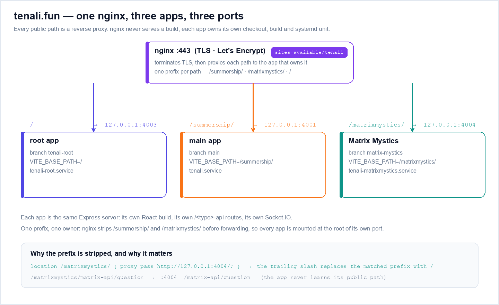
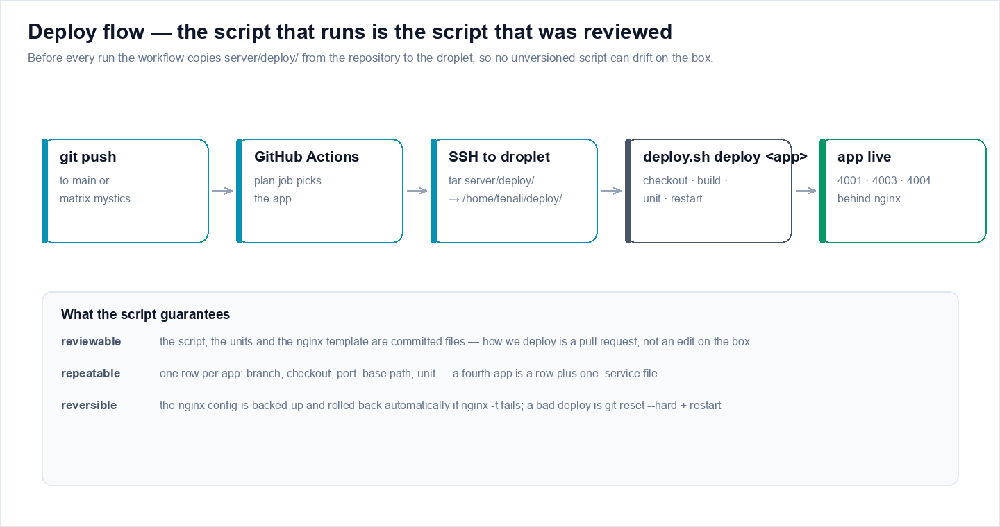
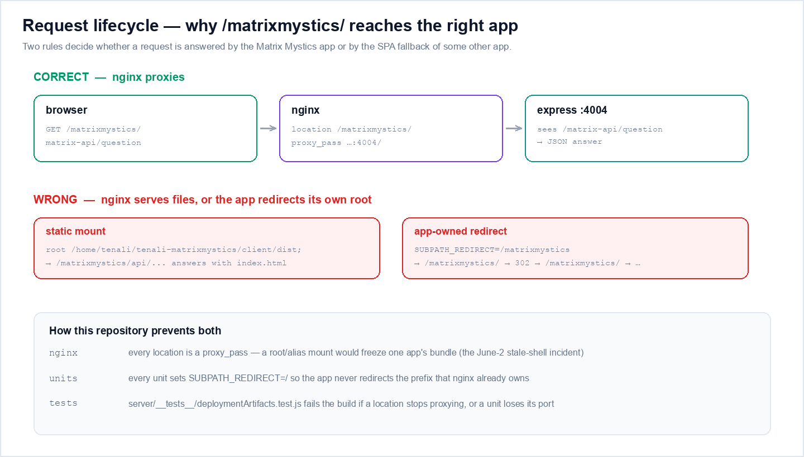

# Tenali deployment

## Topology

`tenali.fun` is one nginx host in front of **three separately-built apps**.
Each app is its own git branch, its own checkout, its own client build and its
own systemd unit. nginx is only a TLS terminator and reverse proxy — it never
serves a build itself.

```
Internet
   │
   ▼
nginx :443 (TLS via Let's Encrypt)
   │
   ├── /                → 127.0.0.1:4003  tenali-root.service      (branch tenali-root)
   ├── /summership/     → 127.0.0.1:4001  tenali.service           (branch main)
   ├── /matrixmystics/  → 127.0.0.1:4004  tenali-matrixmystics.service (branch matrix-mystics)
   └── /fln/            → served by vicharanashala/fln (a different repository)
```

Each app's Express process serves its own React build plus every
`/<type>-api/*`, `/api/*` and `/socket.io` route that belongs to it.



| App | Branch | Checkout on the box | Port | Public path | Client base path |
|-----|--------|---------------------|------|-------------|-------------------|
| main | `main` | `/home/tenali/tenali` | 4001 | `/summership/` | `/summership/` |
| root | `tenali-root` | `/home/tenali/tenali-root` | 4003 | `/` | `/` |
| matrixmystics | `matrix-mystics` | `/home/tenali/tenali-matrixmystics` | 4004 | `/matrixmystics/` | `/matrixmystics/` |

Every artefact of that table is committed to this repository:

| Artefact | Path |
|----------|------|
| Deploy script | `server/deploy/deploy.sh` |
| systemd units | `server/deploy/systemd/*.service` |
| nginx site template | `server/deploy/tenali-nginx.conf` |
| Deploy workflow | `.github/workflows/deploy.yml` |

The diagrams in this file are generated, not hand-drawn —
`python3 docs/images/deployment/make_diagrams.py` regenerates them from the
same topology that the script and the units describe.

## The deploy script

`server/deploy/deploy.sh` is the single source of truth for what runs on the
droplet. `.github/workflows/deploy.yml` copies the directory to
`/home/tenali/deploy/` on the box **before every run**, so the script that
executes is always the script that was reviewed in the pull request — it can
no longer drift into an unreviewed copy that only exists on the server.

```bash
# on the droplet
bash /home/tenali/deploy/deploy.sh deploy main          # one app
bash /home/tenali/deploy/deploy.sh deploy matrixmystics  # one app
bash /home/tenali/deploy/deploy.sh deploy all            # every app
bash /home/tenali/deploy/deploy.sh nginx                 # install the nginx site
bash /home/tenali/deploy/deploy.sh verify                # HTTP checks per app
bash /home/tenali/deploy/deploy.sh status                # systemd status per app
```



What `deploy <app>` does, in order:

1. `git fetch` + `git reset --hard origin/<branch>` in that app's checkout.
2. `npm ci` for client and server, then build the client with
   `VITE_BASE_PATH=<base path>` for that app.
3. Install the app's systemd unit from `server/deploy/systemd/` and
   `systemctl daemon-reload`.
4. `systemctl restart` the unit, and fail the deploy if it does not stay up.

The app table lives at the top of the script — one row per app:

```bash
main|tenali|main|4001|/summership/|tenali.service
root|tenali-root|tenali-root|4003|/|tenali-root.service
matrixmystics|tenali-matrixmystics|matrix-mystics|4004|/matrixmystics/|tenali-matrixmystics.service
```

## Automatic deploys

`.github/workflows/deploy.yml` runs on every push to `main` (deploys the
`main` app) and on every push to `matrix-mystics` (deploys the
`matrixmystics` app). A push to a branch that has no app row changes nothing.
The workflow can also be dispatched by hand with an `app` input
(`main`, `root`, `matrixmystics`, `all`).

> The workflow file must exist on the branch it deploys. The `matrix-mystics`
> branch carries its own copy of `deploy.yml`; keep the two copies in sync
> when you change either one.

## nginx

`server/deploy/tenali-nginx.conf` is the site template. Two rules matter.

**1. Everything is a proxy, never a static mount.** A static `root`/`alias`
mount freezes one app's bundle while the other apps keep shipping, and the
app's own `/api/*` calls start being answered with `index.html` — the
white-screen bug from the June-2 stale-shell incident.

**2. The trailing slash on `proxy_pass` is load-bearing.** nginx replaces the
matched location prefix with the trailing `/` before forwarding:

```
/matrixmystics/assets/app.js  →  127.0.0.1:4004  /assets/app.js
/matrixmystics/api/auth/me   →  127.0.0.1:4004  /api/auth/me
```

The app is mounted at the root of its own port and never learns its public
prefix. Exactly one layer owns the prefix, and it is nginx.

Because nginx strips the prefix, **each app must run with
`SUBPATH_REDIRECT=/`** (the unit files set it explicitly). If an app also
redirected its own `/` to a sub-path, `/matrixmystics/` would bounce between
nginx and Express forever.



## Environment

Required in production:

| Var | Default | Notes |
|-----|---------|-------|
| `NODE_ENV` | — | Must be `production`. Triggers JWT fail-fast. |
| `JWT_SECRET` | dev fallback | **Required.** Server refuses to start in production without it. |
| `MONGO_URI` | `mongodb://127.0.0.1:27017/tenali` | If unreachable, auth falls back to in-memory. |
| `TENALI_SEED_USERS` | empty | `user:pass[,user:pass:admin,…]`. One admin required for proctor dashboard. |
| `JWT_TTL` | `14d` | Token lifetime. |
| `CORS_ORIGINS` | `https://tenali.fun,…` | Comma-separated allowlist. |
| `PORT` | `4000` | Set per app by its systemd unit (4001 / 4003 / 4004). |
| `SUBPATH_REDIRECT` | `/matrixmystics` | Set per app by its systemd unit (`/summership` for main, `/` for root and matrixmystics). `/` disables the root redirect. |
| `VITE_BASE_PATH` | `/` | Build-time client base path. Set to the app's public path when building. |

Per-app values live in the unit files, not in the code, so switching an app
between "mounted at a sub-path" and "serving the domain root" is a one-line
change that is reviewable in git.

## Verification

After a deploy:

```bash
curl -I https://tenali.fun/summership/          # 200, main app
curl -I https://tenali.fun/matrixmystics/       # 200, Matrix Mystics
curl -s  https://tenali.fun/matrixmystics/matrix-api/question?difficulty=0
```

The API call must answer with `application/json`. A `text/html` answer means
the request fell through to the SPA catch-all — the prefix is not being
stripped, or the app is not the one that owns the route.

## Rolling back

```bash
# 1. Put the previous commit back on the branch and let CI redeploy
git revert <sha> && git push

# 2. Or, on the box, check out the previous revision and restart
git -C /home/tenali/tenali-matrixmystics reset --hard <previous-sha>
sudo systemctl restart tenali-matrixmystics
```

The nginx config is installed with a backup next to it
(`tenali-nginx.conf.bak.<timestamp>`) and is rolled back automatically if
`nginx -t` fails.

## Adding a fourth app

1. Add a row to the table in `server/deploy/deploy.sh`.
2. Add `server/deploy/systemd/<app>.service` with the matching port and
   `SUBPATH_REDIRECT=/`.
3. Add a `location` block to `server/deploy/tenali-nginx.conf` that proxies
   to the new port.
4. Add the branch to the `push.branches` list in `.github/workflows/deploy.yml`
   and map it to the new app in the `plan` job.
5. Add a case to the `verify` assertions in
   `server/__tests__/deploymentArtifacts.test.js` so the new app cannot be
   added without its unit and proxy.
