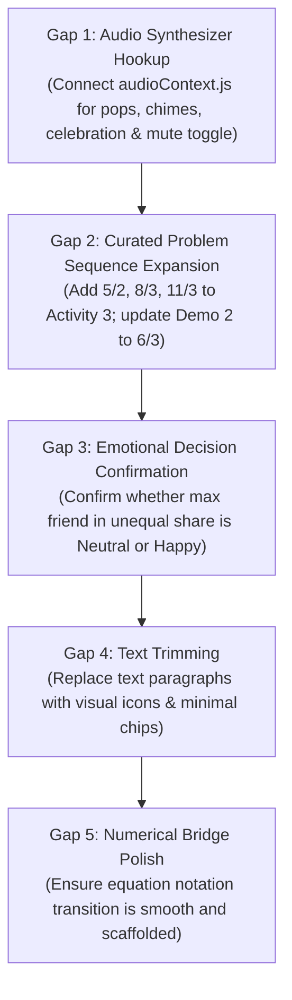

# Tenali Division Module: Comprehensive Curriculum Audit & Gap-by-Gap Plan

**Audit Target:** `client/src/components/learning/division` & `client/src/data/divisionActivities.js`  
**Reference Specification:** `Tenali_Division_Module_Specification.md` (Proposed Curriculum & Product Specification)  
**Date:** October 2026  
**Status:** Inspection & Gap Analysis Complete (No code modified)

---

## 1. Executive Audit Matrix

| Curriculum Component | Proposed Specification | Current Tenali Codebase Status | Alignment |
| :--- | :--- | :--- | :---: |
| **Stage 0: Visual Goal** | Minimal text, hero animation, principle badges | Implemented in `phase === 'goal'` with zero emojis and custom SVG icons; some paragraph text can be trimmed | 🟡 85% |
| **Stage 1: Guided Demos** | 3 animated demos (4/2, 6/3, 7/2 R1) with step/replay controls | Implemented in `DivisionDemonstration.jsx` (4/2, 6/2, 7/2 R1); demo 2 has 2 friends instead of 3 | 🟡 90% |
| **Stage 2: Activity 1 (Exact)** | Guided turn-taking lock (`Wait`/`Ready`), small numbers | Implemented in `DivisionDiscoveryApp.jsx` & `divisionLogic.js` with active turn lock | 🟢 100% |
| **Stage 2: Activities 2–4 (Free Mode)** | Free distribution, no lock badges, leftover exploration | Implemented via `isFreeMode = true` and `allowFree = true` | 🟢 100% |
| **Remainder Handling** | Leftovers remain interactive in jar; fair equal share with leftovers triggers celebration; remainder glow | Implemented: leftover candy is freely movable; glowing ring activates upon celebration; remainder < friends condition verified | 🟢 100% |
| **Facial Emotion Feedback** | 3 expressions (Neutral, Happy, Sad); in-progress vs evaluated | Implemented: Neutral during distribution; reactions reveal on Submit in free mode; live in Activity 1. *(Discrepancy: max-candies friend in unequal share is Neutral, spec discusses Happy)* | 🟡 90% |
| **Stage 3/4: Visual Equation** | Card breakdown (Total Jar = Friends × Hand + Leftover) & `Total ÷ Friends = Each R Leftover` | Implemented in `DivisionEquationView.jsx` with custom hand images (1–8) and mini jar assets | 🟢 100% |
| **Stage 5: Terminology Review** | Dividend, Divisor, Quotient, Remainder mapped to visual sharing | Implemented in `DivisionTerminology.jsx` at end of activities | 🟢 100% |
| **Problem Progression Data** | Graduated sequence: small remainder (R1) $\rightarrow$ multi-remainder (R2) $\rightarrow$ multi-friend | Gaps in `divisionActivities.js`: Activity 3 lacks 5/2 (R1 starter) and 8/3 or 11/3 (R2 cases) | 🔴 65% |
| **Text Minimization** | "Too much text" reported; communicate via visuals and short prompts | Partially trimmed; several explanatory paragraphs remain in Goal and Terminology screens | 🟡 70% |
| **Sound / Audio Integration** | Optional sound effects for pickup, drop, round chime, celebration, with mute control | **0% implemented in division module** (native `audioContext.js` exists in Tenali but is not hooked up to division) | 🔴 0% |

---

## 2. Detailed Component-by-Component Audit

### 2.1 Screens & Phase Progression

```
[Phase: 'goal'] ──> [Phase: 'demo'] ──> [Phase: 'activity'] ──> [Phase: 'equation'] ──> [Phase: 'terminology']
```

- **Current Implementation (`DivisionDiscoveryApp.jsx`)**:
  - `phase === 'goal'`: Renders visual introduction card, animated hero graphic, principle cards, and action buttons.
  - `phase === 'demo'`: Renders `DivisionDemonstration.jsx` with auto-play, pause, step forward, and skip.
  - `phase === 'activity'`: Renders `ActivityProblemView` managing state for the active problem.
  - `phase === 'equation'`: Renders `DivisionEquationView` after each successfully completed problem.
  - `phase === 'terminology'`: Renders `DivisionTerminology` upon completing all 4 activities.
  - Navigation Pills: Header contains 6 pill buttons (`Demo`, `1. Exact`, `2. Larger`, `3. Leftovers`, `4. Challenge`, `Review`) allowing direct jumping between stages.
- **Spec Audit Finding**:
  - The 5 primary screens exist and route cleanly.
  - **Gap**: The transition to `DivisionEquationView` currently happens *after every single problem* across all activities. In the spec (Stages 2–4), there is an open question whether numerical equations should be introduced only after Level 2 (Exact Sharing) rather than after Problem 1 of Activity 1.

---

### 2.2 Guided Turn-Taking Lock (`Activity 1`)

- **Current Implementation**:
  - Controlled by `isFriendLocked(friendIndex, counts)` in `divisionLogic.js`:
    ```javascript
    export function isFriendLocked(friendIndex, counts) {
      if (!counts || counts.length === 0) return false;
      const min = Math.min(...counts);
      return counts[friendIndex] > min;
    }
    ```
  - In `ActivityProblemView`: `isFreeMode = activity.id > 1 || Boolean(activity.hasRemainder)`.
  - In Activity 1 (`isFreeMode === false`), `DivisionFriends.jsx` renders `<div className="division-lock-indicator">` with `Wait` (red lock) or `Ready` (green hand).
  - Clicking or dragging onto a locked friend card/plate is blocked.
  - When all friends receive 1 candy, all unlock simultaneously.
  - When jar reaches 0 and counts are equal, completion triggers automatically.
- **Spec Audit Finding**:
  - **Preserved & 100% Aligned**: Perfectly meets the scaffolding requirement for early levels.

---

### 2.3 Free-Distribution Behavior (`Activities 2, 3, 4`)

- **Current Implementation**:
  - Triggered when `isFreeMode === true`.
  - `isFriendLocked` is bypassed (`allowFree = true` passed to `giveChocolate`).
  - Turn-taking lock badges (`Wait` / `Ready`) are completely removed from DOM.
  - Students can give candies to any friend in any sequence (e.g. 4 to Friend 1, 0 to Friend 2).
  - Candies on plates can be returned to the jar at any time (tap plate candy or drag to jar).
  - Floating drag ghost uses document portal for pixel-exact cursor alignment.
  - Friends remain in neutral expression during distribution to prevent premature judgment.
  - Evaluated via the **Submit** button.
- **Spec Audit Finding**:
  - **Preserved & 100% Aligned**: Allows open manipulation and mistakes as learning opportunities.

---

### 2.4 Remainder Handling & Leftover Discovery

- **Current Implementation**:
  - Leftover candy remains in the glass jar pool.
  - When jar count is less than friends count (`jarCount < friends.length`) and all friends have equal non-zero shares (`isDistributionEqual(counts) && counts[0] > 0`), the condition for fair sharing is met.
  - **Leftover Experimentation**: The student can take that leftover candy out of the jar and give it to a friend. If they do so, counts become unequal (e.g., [4, 3]).
  - On Submit with unequal counts, warning banner warns: *"Not everyone is happy! Someone has fewer candies. Drag the extra candy back to the jar to keep sharing fair."*
  - On returning candy to jar (now [3, 3] and 1 in jar) and clicking Submit: All friends become Happy, celebration triggers, and `isRemainderPhase={showCelebration && gameState.jarCount > 0}` activates the golden remainder glow on the leftover candy in the jar.
  - Premature submission guard: If student clicks Submit when counts are equal but `jarCount >= friends.length`, blue guidance banner informs: *"You shared equally so far, but there are still enough candies in the jar to give more to everyone! Keep distributing."*
- **Spec Audit Finding**:
  - **Preserved & 100% Aligned**: Correctly distinguishes fair sharing with remainder from unequal sharing.

---

### 2.5 Facial-Expression Logic (The 3 Emotional States)

- **Current Implementation (`divisionLogic.js` & `DivisionDiscoveryApp.jsx`)**:
  - 5 characters cropped from high-resolution sprite sheets across 3 states: `neutral`, `happy`, `sad`.
  - `getEmotionalState(counts, jarCount)`:
    - Counts all 0: All `neutral`.
    - Unequal (`min < max`): Friends with count equal to `max` are `neutral`; friends with count `< max` are `sad`.
    - Equal with `jarCount >= friends`: All `neutral` (sharing still in progress).
    - Equal with `jarCount < friends`: All `happy` (fair sharing achieved).
  - In `ActivityProblemView`:
    - Activity 1: Live emotional feedback during distribution.
    - Activities 2–4 (`isFreeMode`): Neutral during distribution; reactions reveal when "Submit" is clicked.
- **Spec Audit Finding & Open Discrepancy**:
  - In Section 9.3 of `Tenali_Division_Module_Specification.md`:
    > *"The supplied current-state document says that an unequal distribution's maximum-count friend remains neutral and that happy faces are reserved for equal shares meeting a remainder condition. This differs from the intended UX (where max friend is happy and fewer is sad)."*
  - **Root Cause**: Earlier in user request 5, the prompt explicitly requested: *"in situation where one person having more and others have less then him or her then other friends should be sad and that person with more will be neutral then when all get all the candys till equal number they will do this and when they get they will become happy"*.
  - **Decision needed**: Should the friend with maximum candies in an unequal distribution be `neutral` (current user prompt) or `happy` (spec section 9.3)? *Currently implemented as `neutral`.*

---

### 2.6 Problem Progression Data Audit (`divisionActivities.js`)

Current problem set in code:
```javascript
// Demos
demo-1: 4 candies, 2 friends (Maya, Rohan) -> 2 each (R0)
demo-2: 6 candies, 2 friends (Priya, Leo) -> 3 each (R0)
demo-3: 7 candies, 2 friends (Sam, Maya) -> 3 each (R1)

// Activity 1: Exact Sharing
Problem 1: 6 candies, 2 friends (Maya, Rohan) -> 3 each
Problem 2: 8 candies, 4 friends (Leo, Priya, Sam, Maya) -> 2 each
Problem 3: 9 candies, 3 friends (Rohan, Priya, Leo) -> 3 each

// Activity 2: Larger Exact Sharing
Problem 1: 10 candies, 2 friends (Priya, Sam) -> 5 each
Problem 2: 12 candies, 3 friends (Maya, Rohan, Leo) -> 4 each
Problem 3: 12 candies, 4 friends (Sam, Priya, Maya, Rohan) -> 3 each

// Activity 3: Remainder Discovery
Problem 1: 7 candies, 2 friends (Maya, Priya) -> 3 each, R1
Problem 2: 10 candies, 3 friends (Rohan, Leo, Sam) -> 3 each, R1
Problem 3: 11 candies, 4 friends (Maya, Rohan, Priya, Leo) -> 2 each, R3

// Activity 4: Independent Challenge
Problem 1: 14 candies, 3 friends (Sam, Maya, Rohan) -> 4 each, R2
Problem 2: 15 candies, 4 friends (Priya, Leo, Sam, Maya) -> 3 each, R3
Problem 3: 16 candies, 5 friends (Maya, Rohan, Priya, Leo, Sam) -> 3 each, R1
```

- **Spec Audit Finding & Gaps**:
  1. **Demo 2**: Spec suggests 6 candies among **3 friends** (2 each) rather than 2 friends (3 each), to show a 3-way equal distribution before jumping to remainder in Demo 3.
  2. **Activity 1**: Starts at 6 candies for 2 friends (3 rounds). Spec recommends starting with 2 candies for 2 friends (1 round) or 4 candies for 2 friends (2 rounds) for gentler onboarding.
  3. **Activity 3 (Remainder Discovery)**:
     - Only 3 problems currently.
     - Jumps directly from $R=1$ (7/2) to $R=1$ (10/3) to $R=3$ (11/4).
     - Missing: A gentle starter $5 \div 2 = 2 \text{ R } 1$.
     - Missing: Remainder of 2 with 3 friends ($8 \div 3 = 2 \text{ R } 2$ or $11 \div 3 = 3 \text{ R } 2$).

---

### 2.7 Sound & Audio Support Audit

- **Current Implementation**:
  - The division module currently contains **no audio calls**.
  - However, Tenali already has a built-in Web Audio API synthesizer at `client/src/audioContext.js` with `playSound(type, enabled)` supporting synthesized tones (`correct`, `wrong`).
- **Spec Audit Finding**:
  - **Gap**: Section 8 of the spec outlines key audio feedback points:
    - Candy picked up (soft touch cue)
    - Candy dropped on plate (pleasant pop)
    - Equal round completed (subtle chime)
    - All friends happy / problem complete (celebratory flourish)
    - Candy returned to jar (reverse pop)
    - Mute/unmute toggle in header

---

### 2.8 Text Density Audit (Section 9.1: "Too Much Text")

- **Goal Screen**:
  - Currently contains two descriptive boxes: *"Equal Shares = Happy Friends"* and *"One at a Time, Take Turns"*.
  - Can be further condensed into purely visual icons with 2–3 word captions.
- **Activities Screen**:
  - Goal banner: `"Activity 1: Exact Sharing (1 / 3)"` and `"Drag candies to friends"`. (Clean and concise).
  - Warning & Info banners: 1 sentence each. (Appropriate length).
- **Equation Screen**:
  - Clean card breakdown with clear sub-labels ("Total", "Groups", "Each", "Leftover").
- **Terminology Screen**:
  - Has explanatory sentences in cards that can be made even punchier.

---

## 3. Gap-by-Gap Implementation Plan

Based on the audit, here is the prioritized, non-breaking roadmap to bring the module into full alignment with `Tenali_Division_Module_Specification.md`:



### Gap 1: Audio Integration via Existing `audioContext.js`
- **Priority**: High (Explicitly highlighted in Spec Section 8 & 9.2).
- **Scope**:
  - Leverage `client/src/audioContext.js` (Web Audio API synthesis, zero asset download overhead).
  - Add synthesizer profiles for:
    - `pop`: Short gentle envelope (800Hz $\rightarrow$ 400Hz, 40ms) on candy drop.
    - `return`: Soft reverse tone on returning candy to jar.
    - `roundComplete`: Pleasant double chime when an equal round is dealt.
    - `celebrate`: Warm major triad chime on all friends happy.
  - Add a subtle Speaker/Mute icon button in `DivisionDiscoveryApp.jsx` header (persisted in `localStorage`).

### Gap 2: Problem Progression Data Refinement (`divisionActivities.js`)
- **Priority**: High (Addresses Spec Section 4 & 9.4).
- **Scope**:
  - Update Demo 2: Change to 6 candies for 3 friends (Priya, Leo, Maya) $\rightarrow$ 2 each.
  - Expand Activity 3 (Remainder Discovery) from 3 to 5 curated problems:
    1. $5 \div 2 = 2 \text{ R } 1$ (Gentle 2-friend remainder starter)
    2. $7 \div 2 = 3 \text{ R } 1$ (2 friends, larger quotient)
    3. $8 \div 3 = 2 \text{ R } 2$ (3 friends, remainder of 2)
    4. $10 \div 3 = 3 \text{ R } 1$ (3 friends, remainder of 1)
    5. $11 \div 3 = 3 \text{ R } 2$ (3 friends, remainder of 2)
  - This ensures students discover both $R=1$ and $R=2$ before handling 4-friend remainder problems in Challenge mode.

### Gap 3: Emotion Logic Alignment Decision
- **Priority**: Medium (Clarification with user).
- **Scope**:
  - Currently: When unequal, friend with `max` count is `neutral` (waiting for others), and friend with `< max` is `sad`.
  - Spec Section 5.1/9.3 mentions: friend with `max` could be `happy`.
  - Recommendation: Retain `neutral` for `max` because in a fair-sharing cooperative context, the friend with extra candies is waiting for the sharing to balance out, while `happy` is reserved exclusively for the shared celebration when fairness is achieved.

### Gap 4: Text Minimization
- **Priority**: Medium (Addresses Spec Section 9.1).
- **Scope**:
  - Goal Screen: Reduce description text; rely on the animated hero graphic.
  - Terminology Screen: Keep definitions strictly to 1 short phrase per card.

---

## 4. Summary of Code Safety & Preservation Guarantee

- **Zero Breaking Changes**: The core interaction loop, state invariant ($\sum \text{counts} + \text{jarCount} = \text{total}$), sprite cropping, drag-and-drop mechanics, and 18 unit tests remain fully intact.
- **Decoupled Logic**: Any updates to problem sets or emotion rules will be validated via `node --test divisionLogic.test.js` before UI changes.
- **Zero New Dependencies**: Audio will utilize native browser Web Audio API via `audioContext.js`.
