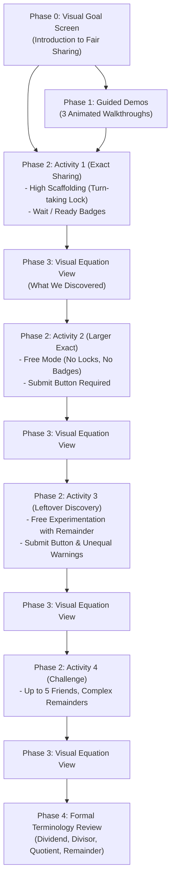

# Tenali Division Learning Module: Complete State & Flow Specification

This document provides a comprehensive, end-to-end explanation of the current state of the **Division Learning Module** in Tenali (`client/src/components/learning/division`). It details what appears on screen at every phase, how students interact with the candies and friends, how emotional reactions are triggered, and what happens step-by-step from initial launch to making friends happy, deriving equations, and reviewing mathematical terminology.

---

## 1. High-Level Architecture & Pedagogical Philosophy

The module teaches division through **physical fair sharing of candies** before introducing formal mathematical abstraction:
1. **Concrete Manipulation**: Physically distributing tangible candies from a jar onto friends' plates.
2. **Emotional Feedback**: Observing friends' real-time and submitted emotional expressions (Neutral, Happy, Sad) to understand equality and fairness.
3. **Free Experimentation**: Testing unequal distributions and leftovers without artificial lockouts.
4. **Visual Synthesis**: Bridging physical actions to visual cards (Jar = Friends × Hand + Leftover).
5. **Formal Abstract Mathematics**: Introducing equation notation (`Total ÷ Friends = Each R Leftover`) and formal terms (*Dividend, Divisor, Quotient, Remainder*).

### Strict Visual & Asset Standards
- **Zero Emojis**: Replaced entirely by custom SVG icons (`DivisionIcons.jsx`) and cartoon assets.
- **5 Consistent Characters**: Maya, Rohan, Priya, Leo, and Sam maintain identical hairstyles, clothes, and accessories across all three emotional states (`neutral`, `happy`, `sad`) via high-resolution sprite sheets.
- **Photorealistic Assets**: Transparent glass candy jar with wooden lid knob, realistic wrapped candies, and hand illustrations holding 1 to 8 candies.

---

## 2. Complete Phase Progression Overview

---

## 3. Step-by-Step Screen Walkthrough

### Phase 0: Visual Goal Screen (`phase === 'goal'`)
When the user first opens the Division module:
- **Header**: Top navigation bar with "← Back to Home" and step indicator pills (`Demo`, `1. Exact`, `2. Larger`, `3. Leftovers`, `4. Challenge`, `Review`).
- **Hero Illustration**: Animated graphics showing candies moving towards smiling friends (Rohan, Priya, Maya).
- **Core Principle Badges**:
  - *Equal Shares = Happy Friends* (3 happy icons).
  - *One at a Time, Take Turns* (lock to hand icon transition).
- **Action Buttons**:
  - `Start Drag & Drop Sharing` (primary): Jumps directly to Activity 1.
  - `Watch Guided Demo` (secondary): Opens the animated demonstration.

---

### Phase 1: Guided Demonstrations (`phase === 'demo'`)
Walks learners through automated demonstrations before they interact:
1. **Demo 1**: 4 candies shared between 2 friends (2 each, 0 leftover).
2. **Demo 2**: 6 candies shared between 2 friends (3 each, 0 leftover).
3. **Demo 3**: 7 candies shared between 2 friends (3 each, 1 leftover in jar).
- **Visuals**: Candies float smoothly from the jar to each friend's plate one at a time.
- **Controls**: Pause, Replay, Step-by-step advance, or "Skip to Activities".

---

### Phase 2: Interactive Sharing Activities (`phase === 'activity'`)

The board is composed of two primary interactive zones:
1. **The Glass Candy Jar (Left)**:
   - Contains the candies pool.
   - Wooden lid knob with glass specular reflection.
   - Candy count badge showing remaining candies in the jar.
   - Can be clicked/tapped or dragged directly onto any friend's plate.
2. **The Friends Row (Right)**:
   - Cartoon friend avatars (size dynamically adjusts from 96px to 116px based on group size).
   - Ceramic plates below each friend serving as drop targets for candies.
   - Candies on plates can be tapped or dragged back to the jar at any time.

#### Scaffolding Difference: Activity 1 vs. Activities 2, 3, 4

| Feature | Activity 1 (Exact Sharing) | Activities 2, 3, 4 (Free Mode) |
| :--- | :--- | :--- |
| **Turn-Taking Lock** | **Active**: Friends who received a candy are locked (`Wait`) until others catch up. | **Removed**: Students can distribute candies to anyone in any order. |
| **Lock Indicators** | Shows `Wait` (red lock) or `Ready` (green hand) pills. | **Hidden**: No lock pills appear; all friends are always ready. |
| **Friend Expressions** | Live feedback as candies are dealt. | **Neutral during distribution**; reactions reveal on **Submit**. |
| **Leftover Candy in Jar** | N/A (all problems divide evenly). | **Fully interactive**: Students can freely give leftovers to any friend. |
| **Submission** | Auto-completes when jar is empty. | Requires clicking the **Submit** button to evaluate. |

---

## 4. The 3 Emotional States & Transition Rules

Every friend displays one of three distinct expressions:

| Emotion | Visual Expression | Meaning to Student | When it Appears |
| :--- | :--- | :--- | :--- |
| **Neutral** | Calm, thoughtful, neutral mouth | *"I am waiting for sharing to finish"* or *"I have enough, waiting for others to get theirs."* | 1. All counts are 0 (start). 2. Free distribution in progress before submitting. 3. Unequal distribution: Friend who has the **maximum** candies. 4. Equal distribution, but jar still has enough to share another round (`jarCount >= friends`). |
| **Sad** | Drooped eyes, down-turned mouth | *"This isn't fair; I have fewer candies than my friend!"* | In an unequal distribution: Any friend who has **fewer** candies than the maximum. |
| **Happy** | Big warm smile, joyful eyes | *"Fair sharing is complete! Everyone got an equal share."* | When all friends have an **equal number of candies** (`> 0`) AND remaining candies in the jar cannot be shared equally (`jarCount < friends`). |

---

## 5. Free Experimentation & The Leftover Section Mechanics

In Activity 3 (*Remainder Discovery*, e.g., 7 candies and 2 friends: Maya and Priya) and Activity 4 (*Challenges*):

### Scenario A: Distributing the Leftover Candy (Unequal Share)
1. Student deals 3 candies to Maya and 3 candies to Priya (1 candy remains in the jar).
2. Friends remain **Neutral**. The jar does **NOT** lock or auto-celebrate.
3. The student drags the 7th candy onto Maya's plate (Maya: 4, Priya: 3, Jar: 0).
4. Student clicks **Submit**:
   - Maya (4 candies) displays **Neutral**.
   - Priya (3 candies) displays **Sad**.
   - Warning Banner appears:
     > **Not everyone is happy! Someone has fewer candies. Drag the extra candy back to the jar to keep sharing fair.**
   - Celebration is blocked.

### Scenario B: Returning the Leftover to the Jar (Fair Share)
1. Seeing Priya sad, the student drags Maya's 4th candy back into the glass jar.
2. Maya now has 3, Priya has 3, and Jar has 1.
3. The moment a candy is returned, feedback resets so the student can experiment.
4. Student clicks **Submit**:
   - Both friends have 3 candies (equal!).
   - Jar has 1 candy (`1 < 2 friends`, so it cannot be divided equally).
   - **Both Maya and Priya become Happy!**
   - The remaining candy in the jar displays a glowing gold ring (`jar-remainder-glow`).
   - The **Celebration Banner** opens!

### Scenario C: Submitting Prematurely
1. Student gives 1 candy to Maya and 1 to Priya (Jar still has 5 candies).
2. Student clicks **Submit**:
   - Both friends remain **Neutral**.
   - Blue Guidance Banner appears:
     > **You shared equally so far, but there are still enough candies in the jar to give more to everyone! Keep distributing.**

---

## 6. What Appears After Making Friends Happy?

### Step 1: The Celebration Banner
When fair sharing is verified:
- Friend cards highlight in celebratory green.
- Celebration banner displays:
  - Header: `All Friends Are Happy!` with SVG celebration icon.
  - Subtext:
    - *If exact*: `"Every friend received exactly X candies!"`
    - *If remainder*: `"Every friend received X candies, and Y remain in the jar."`
  - Primary Button: **`See What We Discovered`** (sparkles icon).

---

### Step 2: Visual Equation Derivation (`phase === 'equation'`)
Clicking "See What We Discovered" navigates to the visual equation screen:

1. **Top Numerical Breakdown Row**:
   - `[Total (Dividend)] = [Friends (Divisor)] × [Each (Quotient)] + [Leftover (Remainder)]`
   - Distinct color coding for each term:
     - Blue: Dividend (Total)
     - Green: Divisor (Groups)
     - Orange: Quotient (Each)
     - Amber: Remainder (Left in Jar)

2. **The 3 (or 4) Visual Representation Cards**:
   - **Card 1: Total Candies Jar** — Realistic mini glass jar showing the total candies with the total number badge.
   - **Card 2: Groups (Friends)** — Individual portraits of all participating kids smiling.
   - **Card 3: Each Friend (Hand)** — Illustrated hand holding the exact number of candies each friend received (custom images for 1 to 8 candies).
   - **Card 4: Leftover (if remainder > 0)** — Mini glowing jar displaying the exact leftover candies.

3. **Formal Mathematical Division Line**:
   - Example: `7 ÷ 2 = 3 (remainder 1)`

4. **Action Button**:
   - `Continue` → Moves to the next problem in the activity, or to the next activity.

---

### Step 3: Formal Terminology Review (`phase === 'terminology'`)
After completing all problems across all 4 activities:
- **Title**: *The Names of Division* (with graduation cap icon).
- **Core Equation**: `10 ÷ 3 = 3 R 1` with each number mapped to its official badge.
- **Visual Concept Grid**:
  - **Dividend** (Jar Icon, Blue): *"The total quantity of candies in the jar you started with."*
  - **Divisor** (Group Icon, Green): *"The number of friends sharing the candies equally."*
  - **Quotient** (Plate Icon, Orange): *"How many candies each friend receives on their plate."*
  - **Remainder** (Sparkles Icon, Amber): *"The leftover quantity in the jar that could not be shared equally."*
- **Final Action**:
  - `Take Practice Quiz` or `Return to Home`.

---

## 7. Interactive Controls & Accessibility Summary

- **Pointer / Mouse**: Click-to-select jar, drag candy with cursor-centered ghost, click/drag plate candies back to jar.
- **Touch**: Full touch drag-and-drop support with native scroll cancellation during candy drag.
- **Keyboard**:
  - `Space`: Toggle jar selection.
  - Number keys `1`–`5`: Deal candy directly to friend 1 through 5.
  - `Enter` / `Space` on plates: Return candy.
- **State Integrity**: Single atomic state in `ActivityProblemView` ensures the sum of plate counts and jar count always strictly equals the problem total:
  $$\sum \text{counts} + \text{jarCount} = \text{total}$$
