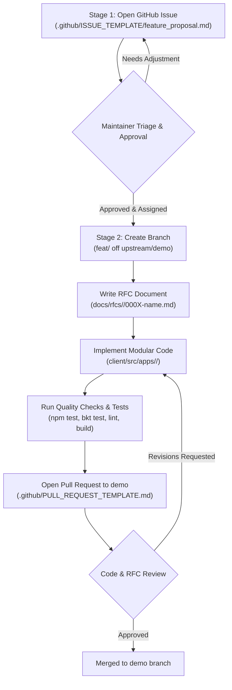

# Feature Proposal & RFC Workflow for Tenali

As Tenali scales development with multiple human contributors, interns, and AI agents collaborating concurrently, a structured process ensures that feature ideas are pedagogically aligned and architecturally sound before code is committed.

This document details the **Issue-to-PR Funnel** and the **Two-Stage RFC Workflow**.

---

## 1. Scope & Applicability

- **Major Features & Educational Modules:** Require the full Two-Stage RFC Workflow (Issue Proposal -> RFC Spec -> Implementation PR).
- **Bug Fixes, Docs, & Small Refactors:** Can bypass the RFC document stage, but must still reference an authorized issue or task on the tracker (`Closes #N`) and target `demo`.

---

## 2. The Two-Stage Workflow



### Stage 1: The Feature Proposal (GitHub Issue)
1. Before writing code or detailed technical architecture, open a **GitHub Issue** using the `Feature Proposal` template ([`.github/ISSUE_TEMPLATE/feature_proposal.md`](../../.github/ISSUE_TEMPLATE/feature_proposal.md)).
2. Focus on:
   - **Problem Statement:** Which learner difficulty or pedagogical bottleneck is being solved? Connect to [`docs/specs/problem-statements.md`](../specs/problem-statements.md).
   - **Feature Description:** What interactive mechanics will be provided?
   - **Research Reference:** Cite cognitive science frameworks or case studies from [`docs/case-studies/`](../case-studies/).
3. Maintainers and peers discuss the proposal on the issue thread. Once consensus is reached, a maintainer assigns the issue with an `approved` label.

### Stage 2: RFC Specification & Implementation PR
1. Create a branch from `upstream/demo`:
   ```bash
   git checkout -b feat/<short-description> upstream/demo
   ```
2. Copy [`docs/templates/0000-rfc-template.md`](../templates/0000-rfc-template.md) to `docs/rfcs/<module>/000X-<short-description>.md`.
3. Detail the technical design: component structure, state management, BKT integration, and UI design compliance.
4. Implement the feature modularly in self-contained directories (e.g. `client/src/apps/<module>/`). **Do not touch monolithic files such as `client/src/App.jsx` or `server/index.js`** without explicit architectural authorization.
5. Verify local tests and linters:
   ```bash
   cd client && npm test
   node ../server/lib/bkt.test.js
   npm run lint
   npm run build
   ```
6. Open a Pull Request targeting **`demo`** using [`.github/PULL_REQUEST_TEMPLATE.md`](../../.github/PULL_REQUEST_TEMPLATE.md).
7. Link the approved proposal issue with `Closes #N`.

---

## 3. Review & Acceptance

- Reviewers verify both the RFC document and the implementation against Tenali's architecture and design system.
- Contributors present progress at standups, demonstrating working software and gathering user feedback.
- Upon final maintainer approval and clean CI checks, the PR is merged into `demo`, archiving the RFC as a permanent record of design decisions.
