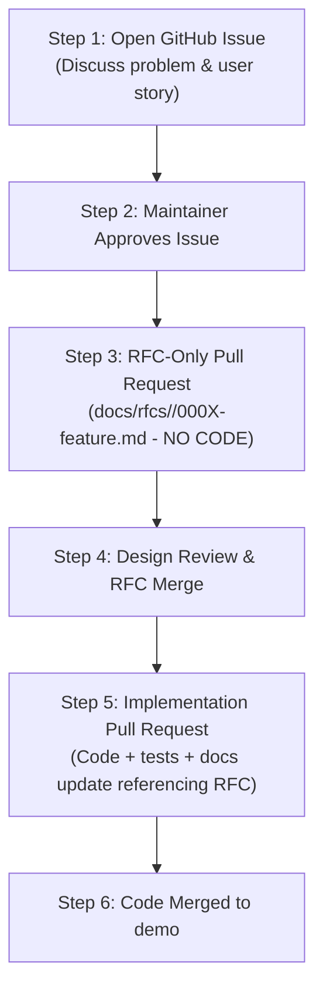

# Tenali RFC Workflow Skill

## 1. Purpose & Trigger
Use this skill whenever proposing, designing, or implementing a new major feature, cross-cutting learning mechanic, architectural migration, or data model change in Tenali.

## 2. When an RFC is Required vs Bypassed

| Change Type | RFC Required? | Workflow |
|---|---|---|
| **Substantial Feature** (new quiz engine, progression system, auth model) | **YES (Mandatory)** | Two-stage workflow: RFC-only PR -> Approval -> Implementation PR |
| **Architectural Refactor** (component extraction batch, router re-architecture) | **YES (Mandatory)** | Two-stage workflow: Architecture RFC PR -> Implementation PR |
| **Bug Fixes** (math logic bugs, timer fixes, broken layout) | **NO** | Standard issue-linked PR (`Closes #N`) |
| **Routine Docs & Typos** (guides, links, contributor stats) | **NO** | Standard issue-linked PR (`Closes #N`) |
| **New Topic Questions** (extending existing generators) | **NO** | Standard issue-linked PR (`Closes #N`) |

---

## 3. The Two-Stage RFC Workflow

### Stage 1: The RFC-Only PR
1. Create a branch: `docs/<feature-name>-rfc`.
2. Copy `docs/templates/0000-rfc-template.md` to `docs/rfcs/<module>/000X-<feature-name>.md`.
3. Complete the technical design: Problem Statement, Research References, High-Level Architecture, API Schema, UI Mockups, Alternatives Considered.
4. Open a Pull Request containing **ONLY documentation** (no implementation code yet).
5. Address maintainer feedback until the RFC is approved and merged into `docs/rfcs/`.

### Stage 2: The Implementation PR
1. Create a feature branch: `feat/<feature-name>`.
2. Implement code following [`skills/tenali-modular-development/SKILL.md`](../tenali-modular-development/SKILL.md).
3. Add tests and run local verification.
4. Open an implementation PR linking both the initial tracking issue (`Closes #N`) and the approved RFC document.
